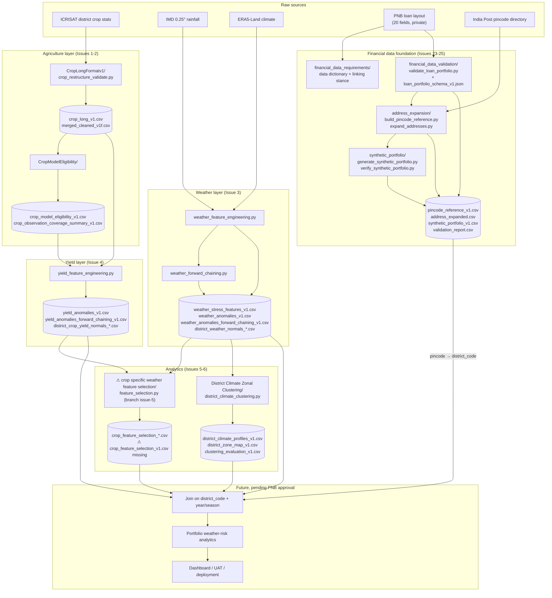
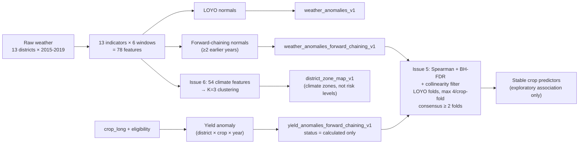
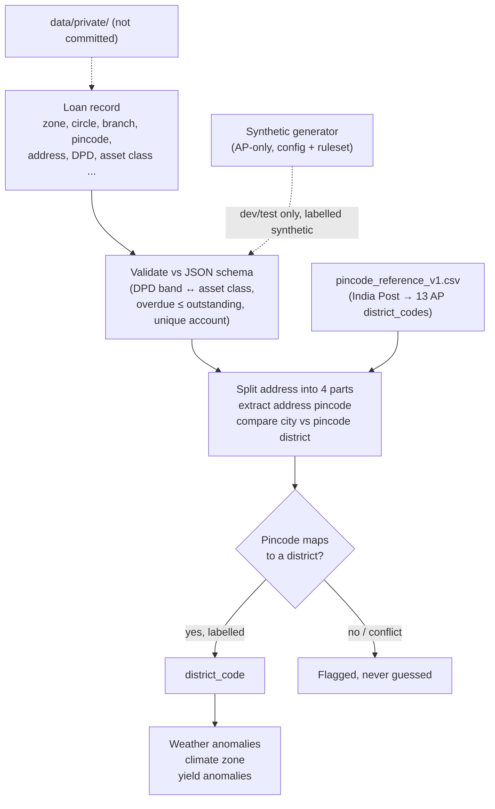

# QWeatherRiskF: Architecture Diagrams

Mermaid diagrams of the project architecture, derived from the repository tree (all branches) and script CLIs.

Legend: ⚠ = exists only on another branch, or not yet built/verified. Financial integration, risk scoring and optimisation are future work pending PNB approval and are not implemented.

## 1. End-to-end system architecture



## 2. Weather and yield pipeline with anomaly methods



Notes:
- LOYO excludes only the held-out year and can use later years. Forward chaining uses strictly earlier years. Issue 5 combines forward-chaining anomalies with LOYO folds, so it is not prospective forecasting.
- Selected predictors are statistical associations, not causal drivers.

## 3. Financial data and the district-key bridge



## 4. Repo and branch workflow

```mermaid
gitGraph
    commit id: "Main"
    branch dev
    commit id: "integration"
    branch issue-3-weather-feature-engineering
    branch issue-4-yield-feature-engineering
    branch issue-5-crop-feature-selection
    branch issue-6-district-climate-zoning
    branch issue-23-address-expansion
    branch issue-24-loan-portfolio-validation
    branch issue-25-synthetic-portfolio
    checkout dev
    merge issue-3-weather-feature-engineering
    merge issue-4-yield-feature-engineering
```

Illustrative only: which branches are merged into `dev` was not verified.

## Known discrepancies

- Issue 5 (`crop specific weather feature selection/`) lives on `issue-5-crop-feature-selection`, not in every checkout.
- Issues 1, 2 and 6 were untracked in the author's local checkout. `CropLongFormatv1/` is duplicated under `Issues/` there.
- The root README mentions ML forecasting, risk scoring and QAOA/Gurobi optimisation. None of that exists in the repo yet.
- The README names `merged_cleaned_v1d.csv`; the repo contains `merged_cleaned_v1f.csv`.
