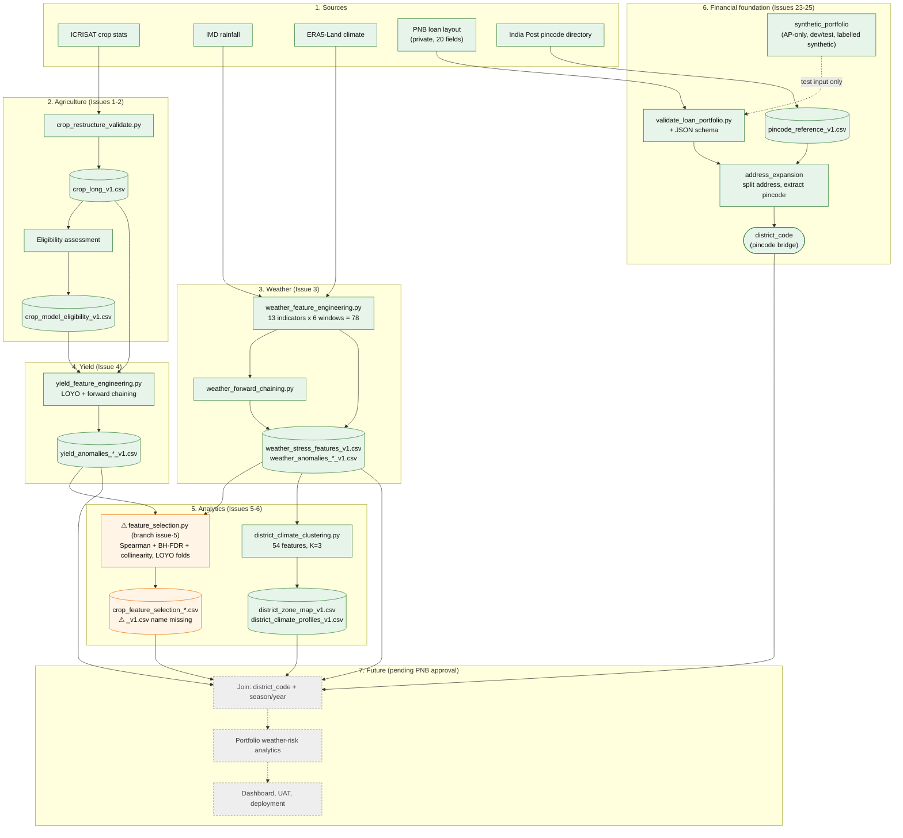

# QWeatherRiskF: Unified Architecture

One diagram covering the whole project: sources, built layers (Issues 1-6, 23-25), and future stages.

Legend: solid = implemented in repo; ⚠ = on another branch or has a gap; dashed/grey "Future" = not built, pending PNB approval.

## Reading notes

- Weather and yield are joined by district and year. The financial side connects only through `district_code`, derived from the loan pincode.
- Climate zones group similar districts. They are not risk levels.
- Issue 5 outputs are exploratory associations (13 districts, 3 scorable years), not a validated prediction model or proof of causation.
- LOYO uses later years in training; forward chaining uses only earlier years. Issue 5 mixes forward-chaining anomalies with LOYO folds, so it is not prospective forecasting.
- Everything in section 7 is planned work. No real PNB financial data is in the repo.
