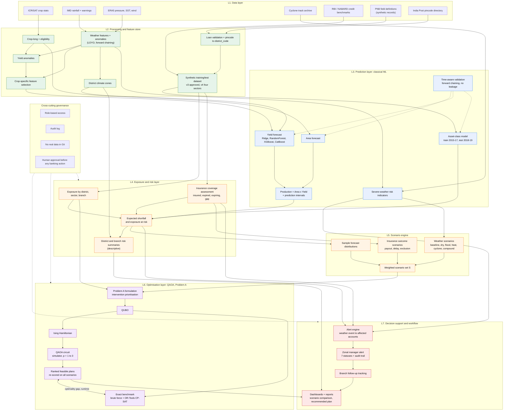
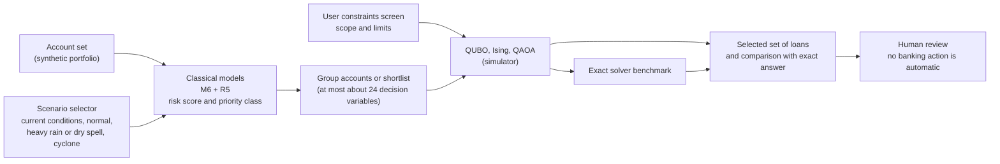
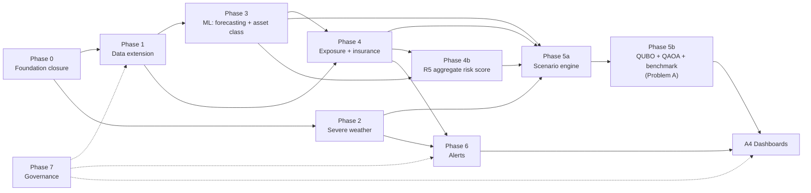

# QWeatherRiskF: Module Roadmap and Hybrid ML + QAOA Architecture

**Audience:** project team
**Status:** Final plan. This is the version we build against.
**Source requirements:** `PNB_requirements.md` (four objectives plus governance).
**Principle:** one coherent end-to-end platform, not disconnected scripts. Synthetic financial data only; PNB supplied field definitions, not records.
**Programme phase:** this file is the **Phase 1 (crop module)** roadmap. The prawn and shrimp module is **Phase 2**: see `QWRF_PHASE2_PRAWN_SHRIMP_ROADMAP.md`. The stages below ("Phase 0" to "Phase 7") are stages inside Phase 1.

---

## 1. Purpose and scope

This document fixes what we are building, in what order, and how the pieces connect. Please treat it as the reference for issue planning and for reviews.

**What the platform does.** It links weather, crop and sector conditions to PNB's agricultural loan exposure and insurance coverage, predicts loan asset class and crop production with classical ML, and then uses QAOA to choose which account groups branch staff should follow up first, under capacity limits. It is decision support. It never takes a banking action.

**Scope (final):**

| Item | Decision |
|---|---|
| Geography | Andhra Pradesh, the 13 districts already used in the weather and yield pipeline |
| Weather and yield history | 2015 to 2019 |
| Agri sectors | Phase 1 models and scores **crop loans** (`Crop Production`). The synthetic portfolio also carries fisheries (prawn and shrimp only), poultry and dairy (`Dairy & Animal Husbandry`) rows for context; prawn and shrimp modelling is Phase 2 |
| Financial data | Synthetic, built from PNB's field definitions. Real PNB records are out of scope |
| Insurance fields | 3, as supplied by PNB (the PNB layout is 20 loan fields + 3 insurance fields): `crop_insurance_available` (Y/N), `insurance_start_date`, `insurance_end_date`. Insured amount, claims and payouts are not in the data, so adequacy of cover cannot be assessed |
| Prediction target for the ML layer | Loan `asset class` (Standard, SMA 0, SMA 1, SMA 2, NPA), plus crop yield and production |
| Optimisation | **Problem A only**: intervention prioritisation (Section 4). Crop allocation is not part of this project |
| Quantum execution | Simulator only. No quantum hardware |
| Loan risk score | A classical classification and scoring step (Section 3.1): per-account aggregate score and priority class. Descriptive; not an approved PNB asset classification |
| Scenario handling | Demo mode: the user picks current conditions or one of 3 named cases (normal, heavy rain or dry spell, cyclone). Full mode: the six weighted scenarios of Section 4.4 |
| Quantum selection input | The user sets scope and limits on a screen (Section 4.8); QAOA selects the set of loans to act on |
| Quantum machine learning | A benchmarked experiment only (Section 4.9). The production risk score stays classical |

## 2. Where we are today

| Area | Status |
|---|---|
| Issues 1-6: crop-long data, eligibility, weather features and anomalies, yield anomalies, crop-specific feature selection, district climate zones | Done and merged to `Main` |
| Issues 21-25: PNB data dictionary, sample handling, address expansion, loan validator, synthetic loan portfolio | Done and merged |
| Issue 32: synthetic training and test dataset (v3: 10,000 train / 1,000 test, out-of-time split 2017-18 vs 2019, target `asset class`) | Done and merged. PNB has reviewed and approved v3. Regenerated on the final Issue 25 generator in PR #34, so the approval needs re-confirming |
| v4 dataset: four agri sectors only, fisheries restricted to prawn and shrimp | Built (PR #34). Pending PNB confirmation. `Fisheries` is not in PNB's original sample domain, so v4 ships its own validator schema |
| v5 dataset: 3 insurance fields, 23-column PNB layout (20 + 3), all dates 2015 to 2019, 100-row sample | Built (PR #53, open). v3 and v4 are kept and marked superseded. PNB approval for v5 not recorded |
| Forecasting, severe-weather module, exposure and insurance risk, scenarios, QAOA, alerts, dashboards | Not started. Plan below |

Open items from the finished work (carried into Phase 0): the Issue 5 deliverable still lacks the exact name `crop_feature_selection_v1.csv`, `Issues/CropLongFormatv1/` duplicates `CropLongFormatv1/`, and there is no shared dependency file at the repository root.

---

## 3. Hybrid architecture

Classical ML predicts. The risk layer turns predictions into exposure. A scenario engine builds weighted combinations of weather, yield and insurance outcomes. QAOA then searches for the best follow-up plan under constraints, and every result is benchmarked against an exact classical solver. Quantum is used for the optimisation step. Prediction and the loan risk score stay classical; a quantum machine-learning classifier is run only as a benchmarked experiment (Section 4.9).



Colour key: green = built, blue = ML prediction, orange = risk and scenarios, purple = QAOA optimisation, red = decision workflow.

### 3.1 Loan risk score and priority class

The risk score is the output of the classical layer. It is a **classification and scoring** step, not an optimisation. The quantum layer takes these scores as input.

| Element | Definition (proposed; to be agreed with the bank) |
|---|---|
| Input | Per-account features from the v5 dataset: loan fields, weather and yield anomalies, climate zone, crop, and the 3 insurance fields |
| Present-value part | The asset-class model (M6) gives a probability for each class. Stress probability `p` = P(SMA 2) + P(NPA) |
| Scenario part | The chosen scenario changes the weather and cyclone inputs and M6 is re-scored, giving a scenario-adjusted `p_s` |
| Insurance-gap part | Status from dates at the reporting date: insured and active, expiring within 30 days, expired, pending, or uninsured. With only 3 fields, the insured amount is unknown, so adequacy of cover cannot be scored |
| Aggregate risk score | A documented combination of `p_s` and the insurance-gap flag, scaled 0 to 100. Weights live in `risk_score_config_v1.json` and are synthetic assumptions |
| Priority class | Score bands (Low, Medium, High, Critical) with cut-offs in the config. A descriptive grouping, **not** an RBI or PNB asset classification |
| Output | Per account: score, class and the contributing parts shown separately. Per account group: average stress probability `p_g` for Problem A |

Rules: the parts of the score are always shown next to the total so a user can see why a loan scores high. The score is not a validated default or NPA predictor. Labels in the synthetic data follow a documented rule, so a good model score shows the pipeline works, not that weather causes loan stress.

### 3.2 End-to-end flow: score, scenario, limits, selection



---

## 4. Optimisation layer: Problem A (intervention prioritisation)

This is the only optimisation problem in the project. Crop allocation is out of scope.

### 4.1 The problem in plain words

When a weather threat is identified, branch staff cannot follow up every borrower. We choose which account groups to follow up so that the insurance and exposure gap we can close is as large as possible, within branch capacity and without overloading any zonal manager.

### 4.2 Definition (final)

| Element | Definition |
|---|---|
| Account group `g` | A district x agri sector x coverage-status cell with a coverage gap. Coverage-gap statuses (from the 3 insurance fields): uninsured, pending, expired, or expiring within 30 days |
| Decision variable | `x_g` = 1 if group `g` is selected for follow-up, else 0 |
| Group data | Accounts `n_g`, exposure `E_g` (sum of outstanding balance), branch set, responsible zonal manager, effort cost `c_g` (accounts x hours per account) |
| Scenario `s` | One of the weighted weather and insurance scenarios, weight `w_s`, sum of weights = 1 |
| Stress probability | `P_gs = min(1, p_g x m_s)`, where `p_g` is the group's average stress probability from the risk score (Section 3.1) and `m_s` is the scenario severity multiplier. In demo mode one scenario is selected with weight 1 |
| Uninsured shortfall | `U_gs = E_g x P_gs x (1 - kappa_g)`, where `kappa_g` = `rho` (a payout-reliability factor below 1) if the group's policies are active at the reporting date, otherwise 0. The insured amount is not in the 3-field data, so a coverage ratio cannot be used. Insurance is never treated as removing credit risk |
| Benefit of selecting `g` | `a_g = alpha x sum_s w_s x U_gs`, where `alpha` is the share of the gap that follow-up closes |

### 4.3 QUBO

Minimise over `x`:

```
- sum_g a_g x_g                                    (benefit)
+ beta  * sum_{g<h, same branch} x_g x_h           (branch workload overlap)
+ gamma * sum_m ( sum_{g in m} c_g x_g - T_m )^2   (balance across zonal managers)
+ lambda * ( sum_g c_g x_g - K )^2                 (total capacity target)
```

- Capacity is a soft quadratic penalty with no slack variables. After sampling, every candidate is checked against the **hard** limits (total effort at most `K_max`, per-branch cap). Infeasible samples are discarded, not repaired.
- The QUBO is converted to an Ising Hamiltonian. The conversion is tested for exact energy equality with the QUBO on random bitstrings.
- Parameters `alpha, rho, beta, gamma, lambda, K, T_m, K_max` live in `optimisation_config_v1.json`. They are synthetic assumptions, documented as such, and covered by a sensitivity sweep. They are not estimated from PNB data.

### 4.4 Scenario set

Six weighted scenarios: baseline, dry kharif, heavy rain or flood, heat stress, cyclone landfall (coastal districts), and a compound dry-plus-heat case. Severity multipliers come from the 2015-2019 anomaly distribution, so they rest on five years of history. Cyclone severity comes from the event catalogue (W2) where available, otherwise from a stated parameter. Scenario weights are documented, sum to 1, and are reduced to a size the QUBO can hold.

### 4.5 QAOA settings and benchmark (final)

| Item | Decision |
|---|---|
| Execution | Statevector simulator. No hardware |
| SDK | Qiskit with the Aer simulator |
| Circuit depth | `p` = 1, 2, 3 |
| Classical optimiser | COBYLA/SPSA, 10 random restarts per instance, fixed seeds |
| Sampling | 4,096 shots, top-k feasible bitstrings re-scored exactly on all scenarios |
| Instance ladder | 8, 12, 16, 20, 24 binary variables (the highest-exposure groups) |
| Exact benchmark | Brute force up to 24 variables, plus OR-Tools CP-SAT on the same QUBO and constraints. Gurobi is not used |
| Reported per instance | Optimal objective, QAOA best feasible objective, optimality gap, approximation ratio, feasibility rate of samples, runtime, seeds, shot noise |

### 4.6 What we will and will not claim

- We report QAOA against the exact solver on every instance. We make **no claim of quantum advantage**. At 8 to 24 variables the classical solvers are exact and faster.
- The linear part of the objective plus the capacity target is a knapsack-type problem that classical solvers solve trivially. The pairwise terms add structure, but the purpose of this layer is a benchmarked, reproducible demonstration of QAOA on a real decision problem, not a speed-up.
- Results depend on the scenario set and the synthetic parameters. "Optimal under the scenario set" does not mean optimal in reality.
- The output is a ranked recommendation for a human reviewer. It never triggers a banking action.

### 4.7 Acceptance criteria for the layer

1. QUBO and Ising energies agree on random bitstrings.
2. On instances up to 24 variables, brute force and CP-SAT return the same optimum.
3. QAOA returns feasible candidates on every ladder rung, and each candidate is re-scored exactly on all scenarios.
4. The gap table (QAOA vs exact, by `p` and size) is published with seeds and config hashes.
5. The recommended plan and its scenario-wise breakdown appear in the dashboard.

### 4.8 User constraints screen and scenario selector

The user, not the code, decides what limits apply. A screen collects the inputs, and the QUBO is built from them.

| Input | Examples | Available in the data today |
|---|---|---|
| Scope filters | District, sector, crop, insured or not, insurance expiring within X days | Yes |
| Loan size | Sanction amount, balance outstanding, cap on total outstanding exposure selected | Yes |
| Capacity | Maximum accounts or effort hours the branches can follow up; per-branch cap | Yes (parameters) |
| Coverage rule | Minimum number or share of loans covered per district | Yes |
| Loan term | Short-term versus long-term | **No.** There is no tenure or maturity date; `facility type` is only a rough proxy |
| Collateral coverage | Collateral against exposure | **No.** Not in the PNB fields |
| Insured amount coverage | Insured amount against outstanding balance | **No.** Not in the 3-field layout |
| Scenario | Current conditions, normal, heavy rain or dry spell, cyclone | Yes, once the cyclone indicators (M4) are built |

Rules:
- Every limit maps to a QUBO penalty or a hard feasibility check after sampling. Invalid inputs are rejected.
- The result is a **set** of loans to act on, not a ranking. Any order inside the set is a classical sort by score.
- Simulators hold about 24 binary variables, so the screen filters first and then groups accounts (district x sector x coverage status) or shortlists the top candidates.
- If the only limit is a count cap, sorting by score gives the exact answer and QAOA adds nothing. The layer is meaningful only with real limits such as per-district minimum coverage, an exposure cap, or correlated cyclone losses. Results are always compared with the exact solver.
- Demo mode uses one selected scenario with weight 1. Full mode uses the six weighted scenarios of Section 4.4.
- Fields marked "No" above would need to be supplied by PNB.

### 4.9 Quantum machine-learning experiment (benchmark only)

A variational quantum classifier (VQC) is tested on the same risk-score classification task as the classical model.

| Item | Decision |
|---|---|
| Task | Predict asset class (or stress versus not) on the v5 dataset, same train and test years as M6 |
| Experiment | Feature-count sweep (for example 4, 8, 12, 16, 20 features), VQC against gradient boosting and logistic regression |
| Execution | Simulator, about 20 qubits at most (one feature per qubit) |
| Reported | Accuracy, macro-F1, runtime, seeds, per feature count |
| Claim | None of quantum advantage. If the classical model wins, we report that |

The production risk score stays classical. The synthetic labels follow a documented rule, so any model recovers that rule; the result says nothing about real borrowers.

---

## 5. Requirement-to-module map

| Objective (from `PNB_requirements.md`) | Modules |
|---|---|
| 1. Crop production forecasting | M1, M2, M3, M5 |
| 2. Insurance integration and loan portfolio risk | D2, D3, R1, R2, R3, R5, M6 |
| 3. Cyclone and severe-weather intelligence | W1, W2, W3, M4 |
| 4. Zonal manager alerts | A1, A2, A3 |
| Loan risk score and priority class | M6, R5 |
| Hybrid scenario optimisation (Problem A) | C1-C4, Q1-Q7 |
| Quantum machine-learning benchmark (experiment) | Q8 |
| Dashboards and reports | A4 |
| Governance | Gv1-Gv4 |

---

## 6. Module roadmap

Status: **Done** = built and merged. **Partly** = some of it exists. **Open** = not started.

### Phase 0: Foundation closure

| ID | Module | Output | Validation | Status |
|---|---|---|---|---|
| F0.1 | Remove the duplicate `Issues/CropLongFormatv1/` folder | single source for crop-long data | no duplicate CSVs; references updated | Open. (Issue 1, 2, 5, 6 folders are already merged to `Main`) |
| F0.2 | Issue 5 deliverable name | `crop_feature_selection_v1.csv` | filename matches the issue; original detailed outputs preserved | Open. (The consensus file exists under another name) |
| F0.3 | Shared dependency file and test runner at repository root | consolidated environment document | clean install and test run | Open |

### Phase 1: Data extension

| ID | Module | Inputs | Outputs | Validation | Status |
|---|---|---|---|---|---|
| D1 | Data dictionary: 20 PNB fields and the 3 insurance fields | PNB field layout | dictionaries in `financial_train_test_data/docs/` | every field has type, sensitivity, source | Done. Cyclone and geography fields still to add |
| D2 | Insurance validation rules for the 3 fields | dataset verifier, validator schema v5 | rules: end date after start date; `crop_insurance_available` is Y or N; dates present for Y and blank for N; dates inside 2015 to 2019 | rule unit tests | Partly. Rules run in the dataset verifier; the validator schema does not yet include them |
| D3 | Synthetic insurance records | synthetic portfolio | included in v3 and v4 (6 fields) and v5 (3 fields) | rules pass; every record synthetic | Done |
| D3b | Synthetic training and test dataset | D3, weather and yield anomalies, climate zones | `financial_train_test_data/` v3 (approved), v4 (four sectors, pending), v5 (3 insurance fields, 23-column layout, dates 2015 to 2019; PR #53) | 14-15 checks pass, none fail; byte-reproducible | Done (v4 awaiting PNB confirmation) |
| D4 | RBI and NABARD benchmark for district allocation | public RBI district credit data, NABARD PLP | allocation table and assumptions list | each assumption tagged "public reference" or "synthetic choice" | Open |
| D5 | Geography master | pincode reference, district-zone-circle mapping | `geography_master_v1.csv` | consistent `district_code` across all datasets; unmatched keys reported | Partly. Pincode-to-district reference is done (Issue 23) |
| D6 | Crop calendar | agronomic public sources | `crop_calendar_v1.csv` | sowing and harvest windows per crop, season-aligned | Open |

### Phase 2: Weather and severe-weather intelligence (Objective 3)

| ID | Module | Inputs | Outputs | Validation | Status |
|---|---|---|---|---|---|
| W1 | Extended meteorological ingestion (pressure, wind direction, SST) | ERA5, IMD | `weather_extended_v1.csv` | coverage; units documented; missing values not imputed | Open |
| W2 | Cyclone track and event catalogue | IMD or IBTrACS archive | `cyclone_events_v1.csv`, affected-district map | track-to-district mapping check | Open |
| M4 | Severe-weather risk indicators | W1, W2 | indicator table | historical back-test, labelled pattern analysis, not forecasting | Open |
| W3 | IMD warning ingestion (authoritative operational input) | IMD advisories | structured warning feed | schema validation; kept separate from model indicators | Open |

Constraint: wind speed and pressure alone do not reliably predict cyclone formation. Official IMD warnings drive operations. The platform does not replace meteorological forecasting.

### Phase 3: Forecasting and asset-class prediction (classical ML)

| ID | Module | Inputs | Outputs | Validation | Status |
|---|---|---|---|---|---|
| M1 | Area forecast | crop-long data, crop calendar | area forecast per crop, district, season | forward chaining; naive-baseline comparison | Open |
| M2 | Yield forecast: Ridge, RandomForest, XGBoost, CatBoost | yield anomalies, Issue 5 stable predictors, Issue 6 zones | yield forecast with intervals | forward chaining only; feature selection inside each fold; must beat the climatology baseline or we report that it does not | Open |
| M3 | Production = Area x Yield with uncertainty | M1, M2 | production forecast with intervals | interval coverage check; both uncertainties propagated | Open |
| M5 | Validation harness | all models | metrics report | leakage tests; per-crop sample-size flags | Open |
| M6 | Asset-class model (classical ML) | `financial_train_test_data/v5` (v4 and v3 as fallbacks) | predicted class and probability per account; per-group `p_g` for Problem A | train 2015-2017, test 2018-2019 (v3 fallback: train 2017-2018, test 2019); report accuracy and macro-F1 against the majority-class and shuffled-label baselines; exclude leakage and post-event columns | Open. Dataset is ready |

Known risks: 13 districts x 5 years is very little history, and only four crops had stable predictors in the Issue 5 run. We extend history if we can, pool crops within climate zones, and shrink toward a trend baseline, and we state plainly where a model does not beat its baseline. No causal claims.

For M6, the synthetic labels follow a documented risk score, so a good score shows that the pipeline works, not that weather causes loan stress. The v5 baseline (gradient boosting, accuracy 0.453, macro-F1 0.418 against a majority-class accuracy of 0.300) is our reference point; the v4 baseline was 0.470 and 0.420.

### Phase 4: Exposure and insurance risk (Objective 2)

| ID | Module | Inputs | Outputs | Validation | Status |
|---|---|---|---|---|---|
| R1 | Exposure aggregation | dataset, geography master | exposure by district, sector and branch | totals reconcile to portfolio control totals | Open |
| R2 | Insurance coverage assessment | 3 insurance fields | insured and uninsured, expired, expiring (30-day window), pending. Coverage against outstanding balance is not possible with 3 fields | rule unit tests | Open |
| R3 | Exposure at risk from predicted stress and forecast shortfall | M3, M6, R1, R2 | exposure-at-risk table | insurance not treated as removing credit risk; exclusions, deductibles, basis risk and payout delay are parameters | Open |
| R4 | District and branch risk summaries | R3, Issue 6 zones | summary tables | climate zones used for grouping only, never as risk labels | Open |
| R5 | Aggregate loan risk score and priority class (Section 3.1) | M6, R2, M4 cyclone indicators, scenario inputs | per-account score, class and parts; per-group `p_g` | parts shown beside the total; weights and bands in `risk_score_config_v1.json`; baseline comparison; descriptive, not an approved asset classification | Open |

### Phase 5: Scenario engine and QAOA (Problem A)

| ID | Module | Inputs | Outputs | Validation | Status |
|---|---|---|---|---|---|
| C1 | Forecast-distribution sampler | M3 intervals | sampled yield and area draws | seeded, reproducible | Open |
| C2 | Weather scenario library (six scenarios) | W2, M4, 2015-2019 anomalies | named scenarios with weights | weights documented and sum to 1 | Open |
| C3 | Insurance outcome scenarios | R2 parameters | payout, delay, exclusion cases | rule tests | Open |
| C4 | Scenario set builder | C1-C3 | `scenario_set_v1` | size cap for QUBO tractability; reduction method documented | Open |
| Q1 | Problem A formulation | R1, R3, C4, `optimisation_config_v1.json` | variables, objective, constraints | tiny instances solved by brute force match the specification | Open |
| Q2 | QUBO builder | Q1 | QUBO matrix | penalty-weight sweep; feasibility rate recorded | Open |
| Q3 | QUBO to Ising converter | Q2 | Ising coefficients | energy equality with the QUBO on random bitstrings | Open |
| Q4 | QAOA runner (simulator) | Q3 | sampled bitstrings, best parameters | `p` sweep; fixed seeds; shot noise reported | Open |
| Q5 | Result processor | Q4 | ranked feasible plans with scenario-wise breakdown | each candidate re-scored exactly on all scenarios; infeasible samples discarded | Open |
| Q6 | Exact benchmark (brute force and OR-Tools CP-SAT) | Q2 | optimal solution | gap and runtime table against QAOA, same instances | Open |
| Q7 | Constraints and scenario-selector input (Section 4.8) | R5, Q1 | screen or config producing the constraint set and chosen scenario for Q1 | every limit maps to a QUBO penalty or a hard check; invalid inputs rejected; demo mode (current or 3 named cases) tested | Open |
| Q8 | Quantum machine-learning experiment: VQC against classical models (Section 4.9) | M6 dataset, R5 | metrics table by feature count | same train and test years as M6; fixed seeds; no advantage claimed | Open |

### Phase 6: Alerts and workflow (Objective 4)

| ID | Module | Inputs | Outputs | Validation | Status |
|---|---|---|---|---|---|
| A1 | Alert generator | W3 or M4 event, R1, R2 | alert records with all required fields | field completeness tests | Open |
| A2 | Alert lifecycle | A1 | statuses: New, Under Review, Assigned to Branch, Follow-up in Progress, Insurance Details Updated, Resolved, Closed | state-machine tests; illegal transitions rejected | Open |
| A3 | Follow-up tracker and audit log | A2 | action history | every transition logged with actor and time | Open |
| A4 | Dashboards and reports | R4, Q5, A1-A3 | exposure, insurance gaps, scenario comparison, recommended Problem A plan | role-based views; synthetic-data banner | Open |

Alert ownership is synthetic: one zonal manager for the Hyderabad zone, three placeholder circles (Vijayawada, Visakhapatnam, Tirupati), and branch personnel per branch from the synthetic portfolio. The platform never enrols borrowers in insurance and never modifies banking records.

### Phase 7: Governance and hardening (runs alongside all phases)

| ID | Module | Output | Status |
|---|---|---|---|
| Gv1 | Role-based access control | roles: zonal manager, branch user, analyst, admin | Open |
| Gv2 | Audit logging | immutable log of sensitive operations | Open |
| Gv3 | Data-handling controls | `/data/private/` stays ignored (already in `.gitignore`); pre-commit check for account-number patterns; synthetic label kept in file names and docs | Partly |
| Gv4 | UAT plan and acceptance metrics | agreed with PNB | Open |

---

## 7. Dependency graph



Critical path: F0 to D2 to R2 to A1 to A2 and A3. Alerts on synthetic data need no ML or QAOA, so they give us the earliest end-to-end demo. The ML and QAOA branches run in parallel and join at the dashboard.

---

## 8. Planned GitHub issues

Issue #32 (the synthetic training and test dataset) is already closed. The remaining work is split as follows. Numbers are assigned when each issue is created.

| Title | Modules | Phase |
|---|---|---|
| Foundation closure: duplicate folder, Issue 5 deliverable name, root dependency file | F0.1-F0.3 | 0 |
| Insurance validation rules and data dictionary extension (cyclone and geography fields) | D1, D2 | 1 |
| RBI and NABARD district allocation benchmark with assumptions table | D4 | 1 |
| Geography master and crop calendar | D5, D6 | 1 |
| Extended meteorological data ingestion | W1 | 2 |
| Cyclone event catalogue and district mapping | W2, M4 | 2 |
| IMD warning ingestion | W3 | 2 |
| Area forecasting | M1 | 3 |
| Yield forecasting and validation harness | M2, M5 | 3 |
| Production forecast with uncertainty | M3 | 3 |
| Asset-class model on the synthetic training and test dataset | M6 | 3 |
| Exposure aggregation and insurance coverage assessment | R1, R2 | 4 |
| Exposure at risk and district and branch summaries | R3, R4 | 4 |
| Aggregate loan risk score and priority class | R5 | 4 |
| Scenario engine | C1-C4 | 5 |
| Problem A formulation, QUBO and Ising conversion | Q1-Q3 | 5 |
| QAOA runner, result processor and exact benchmark | Q4-Q6 | 5 |
| Constraints and scenario-selector input | Q7 | 5 |
| Quantum machine-learning experiment against classical models | Q8 | 5 |
| Alert generator, lifecycle and audit trail | A1-A3 | 6 |
| Dashboards and reports | A4 | 6 |
| Role-based access, audit logging, data-handling controls, UAT plan | Gv1-Gv4 | 7 |

## 9. Planned timeline

These are planning estimates for a team of two to three people working in parallel. They are not commitments, and the biggest swing factor is how quickly PNB answers questions.

| Phase | Planned duration |
|---|---|
| 0. Foundation closure | 1 week |
| 1. Data extension | 3-4 weeks |
| 2. Severe weather | 4-6 weeks |
| 3. ML: forecasting and asset class | 5-7 weeks |
| 4. Exposure and insurance risk | 3-4 weeks |
| 5. Scenario engine, QUBO, QAOA, benchmark | 8-10 weeks |
| 6. Alerts and workflow | 4-5 weeks |
| Dashboards and UAT preparation | 3-4 weeks |
| 7. Governance | alongside all phases |

Overall: about 22 to 26 weeks of calendar time. The first end-to-end demo (alerts on synthetic data, no ML) is realistic around week 10 to 12.

Main schedule risks: PNB turnaround on `Fisheries` and the v4 dataset, data licensing for IMD, ERA5 and cyclone archives (adds 2 to 4 weeks to Phase 2), weak forecasting skill on five years of history, and QUBO penalty tuning in Phase 5.

---

## 10. Engineering rules

- Branch from the current integration branch and open a PR for every module. No direct commits to `Main`.
- Every module ships code, tests, a README with the exact run command, a validation report with real results, and its limitations.
- Missing values are never silently imputed. Missing, insufficient history and true zero stay distinct.
- Forecast validation is forward chaining. Feature selection runs inside each fold. LOYO is not used to claim forecasting skill.
- Every synthetic record is labelled synthetic in its file name and docs. Synthetic data never appears as PNB results.
- Climate zones are similarity groups, not risk levels.
- Scenario and QAOA results are reported with their assumptions, scenario set, seeds, config hash and benchmark gap.
- Commit messages and PR descriptions carry no tool attribution.

## 11. Decisions (final)

| Topic | Decision |
|---|---|
| Optimisation target | Problem A, intervention prioritisation. Crop allocation is out of scope |
| Geography and history | Andhra Pradesh, 13 districts, 2015-2019 |
| Agri sectors | Crop agriculture, fisheries (prawn and shrimp only), poultry, dairy |
| Insurance fields | The 3 listed in Section 1 (PNB layout: 20 loan fields + 3 insurance fields) |
| Quantum execution | Statevector simulator (Qiskit-Aer, for initial work), then move on the hardware.  |
| Exact benchmark | Brute force plus OR-Tools CP-SAT or Gurobi |
| Expiring-policy window | 30 days |
| Alert ownership | Synthetic: one zonal manager for the Hyderabad zone, placeholder circles, branch personnel from the synthetic portfolio. Replaced when PNB provides the real mapping |
| Loan risk score | Classical classification and scoring (Section 3.1). Proposed definition; PNB must agree it before any operational use |
| Quantum selection input | The user sets scope and limits on a screen; QAOA selects the set of loans; always benchmarked against the exact solver (Section 4.8) |
| Scenarios | Demo mode: current conditions or one of 3 named cases. Full mode: six weighted scenarios |
| Quantum machine learning | Benchmarked experiment only; production score stays classical (Section 4.9) |
| Phase 2 (prawn and shrimp) | Separate roadmap, starts after Phase 1 exit criteria are met |
 
