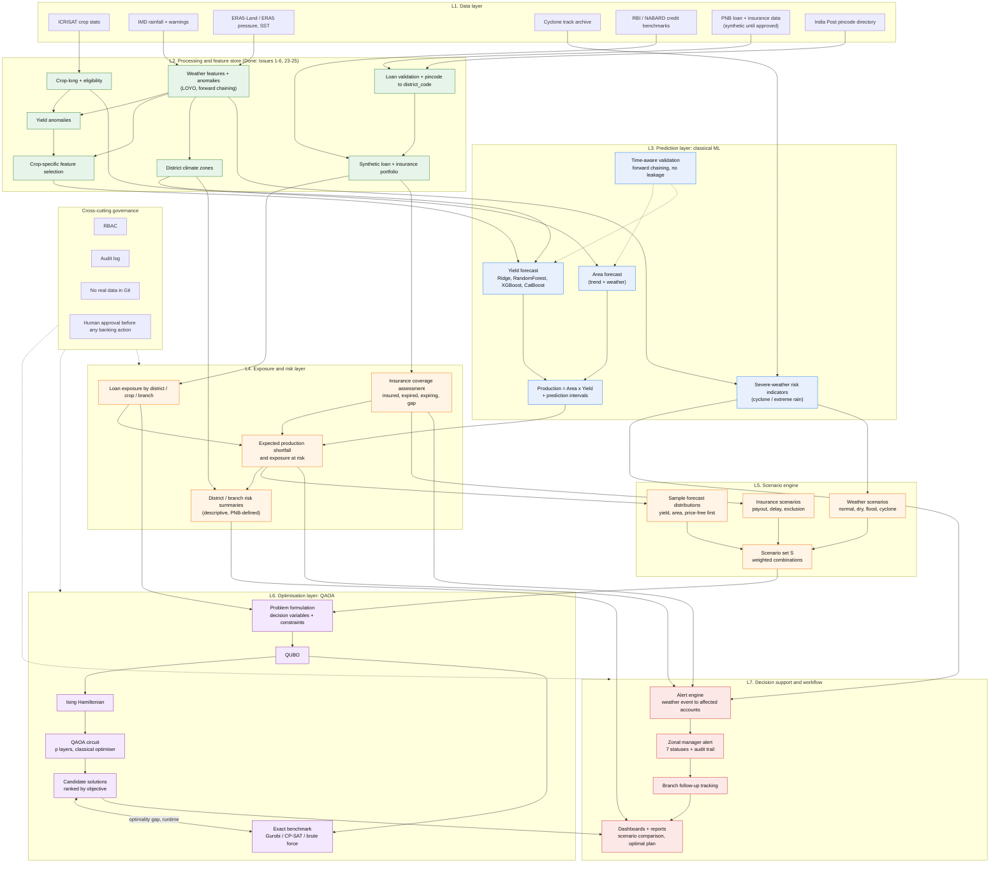
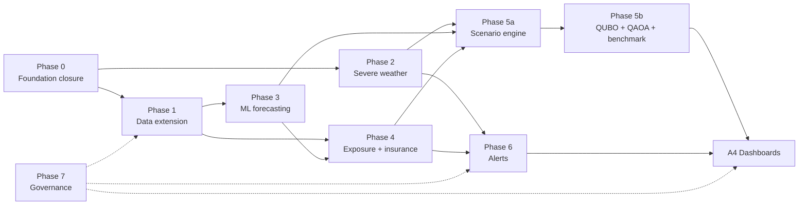

# QWeatherRiskF: Module Roadmap and Hybrid ML + QAOA Architecture

**Status:** Proposed plan. Nothing in Sections 3-6 is implemented unless marked "Done".
**Source requirements:** `PNB_requirements.md` (four objectives plus governance).
**Principle:** Build one coherent end-to-end platform, not disconnected scripts. Synthetic data only until PNB approves real data.

---

## 1. Hybrid architecture (unified)

Classical ML predicts. The risk layer turns predictions into exposure. A scenario engine generates many combinations of weather, yield and insurance outcomes. QAOA then searches for the best decision under constraints, benchmarked against an exact classical solver. Quantum is used only for optimisation, never for prediction.

Colour key: green = done, blue = ML prediction, orange = risk and scenarios, purple = QAOA optimisation, red = decision workflow.

### 1.1 What QAOA optimises

QAOA needs a discrete decision problem small enough for current simulators or hardware. Two candidate formulations, both to be agreed with PNB before building:

| Problem | Binary decision variables | Objective | Constraints |
|---|---|---|---|
| **A. Intervention prioritisation** (primary, fits Objectives 2 and 4) | x_i = 1 if branch follow-up is assigned to account group i (district x crop x insurance-status) | Maximise exposure covered, or minimise expected uninsured loss across scenarios | Branch follow-up capacity, zonal manager workload, minimum coverage per high-exposure district |
| **B. Crop allocation** (from README vision) | x_{c,l} = 1 if crop c is assigned to land block l | Maximise expected profit minus risk penalty across scenarios | Land, water, budget limits; needs price and cost data not yet integrated |

Recommendation: start with **A**. It uses data the project already has or will have, and it directly serves the alert workflow. Treat **B** as a later extension; it depends on price and cost data that are not yet integrated.

### 1.2 Scenario combination search

1. Scenario engine builds a set S of weighted scenarios (weather x yield draw x insurance outcome).
2. The QUBO objective is the scenario-weighted expected loss, optionally plus a CVaR-style tail term (linearised or penalty-encoded).
3. QAOA returns a distribution over bitstrings. Take the top-k as candidate plans, then re-evaluate each candidate exactly on all scenarios classically.
4. Report the optimal plan, runner-up plans, and how the optimal plan changes under each scenario.

### 1.3 Honesty constraints for the quantum layer

- QAOA is benchmarked against an exact solver on every instance. Report the optimality gap and runtime as measured.
- No claim of quantum advantage. At the problem sizes that fit simulators (roughly up to 20-30 qubits), classical solvers are exact and faster.
- Constraints are encoded as QUBO penalties, so penalty weights must be tuned and feasibility checked after sampling. Infeasible samples are discarded, not repaired silently.
- Results depend on the scenario set and the objective definition. Optimal under S is not optimal in reality.
- Optimisation output is decision support. It never triggers a banking action automatically.

---

## 2. Requirement-to-module map

| Objective (from requirements) | Modules |
|---|---|
| 1. Crop production forecasting | M1, M2, M3, M5 |
| 2. Insurance integration and loan portfolio risk | D2, D3, R1, R2, R3 |
| 3. Cyclone and severe-weather intelligence | W1, W2, M4 |
| 4. Zonal manager alerts | A1, A2, A3 |
| Hybrid scenario optimisation (added) | C1-C4, Q1-Q5 |
| Dashboards and reports | A4 |
| Governance | G1-G3 |

---

## 3. Module roadmap

Status: **Done** = in repo or on a branch. **Open** = not started.

### Phase 0: Foundation closure

| ID | Module | Inputs | Outputs | Validation | Status |
|---|---|---|---|---|---|
| F0.1 | Merge Issues 1, 2, 6 into `dev`; remove `Issues/` duplicate | local untracked folders | tracked folders | `git status` clean; no duplicate CSV | Open |
| F0.2 | Issue 5 deliverable name | `crop_feature_selection_consensus.csv` | `crop_feature_selection_v1.csv` | filename matches issue; originals preserved | Open |
| F0.3 | Dependency file and test runner at repo root | per-folder `requirements.txt` | consolidated env doc | clean install and test run | Open |

### Phase 1: Data extension

| ID | Module | Inputs | Outputs | Validation | Status |
|---|---|---|---|---|---|
| D1 | Data dictionary v2 covering insurance, geography, cyclone fields | `PNB_requirements.md`, existing dictionary | dictionary v2 | every field has type, sensitivity, source | Open |
| D2 | Insurance schema extension (13 fields) | `loan_portfolio_schema_v1.json` | schema v2 | end > start; coverage status consistent with dates; payout <= claim; claim needs policy | Open |
| D3 | Synthetic insurance records | synthetic portfolio, D2 | `synthetic_portfolio_v2.csv` | all rows labelled synthetic; proportions match documented assumptions | Open |
| D4 | RBI / NABARD district allocation benchmark | public RBI district credit, NABARD PLP | district account allocation table, assumptions doc | each assumption tagged "public reference" or "synthetic choice" | Open |
| D5 | Geography master | pincode reference, district-zone-circle mapping | `geography_master_v1.csv` | consistent `district_code` across all datasets; unmatched keys reported | Open |
| D6 | Crop calendar | agronomic public sources | `crop_calendar_v1.csv` | sowing/harvest windows per crop, season-aligned | Open |

### Phase 2: Weather and severe-weather intelligence (Objective 3)

| ID | Module | Inputs | Outputs | Validation | Status |
|---|---|---|---|---|---|
| W1 | Extended meteorological ingestion (pressure, wind direction, SST) | ERA5, IMD | `weather_extended_v1.csv` | coverage, units documented, missingness not imputed | Open |
| W2 | Cyclone track and event catalogue | IMD / IBTrACS archive | `cyclone_events_v1.csv`, affected-district map | track-to-district mapping check | Open |
| M4 | Severe-weather risk indicators | W1, W2 | indicator table | historical back-test labelled as pattern analysis, not forecasting | Open |
| W3 | IMD warning ingestion (authoritative operational input) | IMD advisories | structured warning feed | schema validation; clear separation from model indicators | Open |

Constraint: wind speed and pressure alone do not reliably predict cyclone formation. Official IMD warnings drive operations. The platform does not replace meteorological forecasting.

### Phase 3: Forecasting (Objective 1), classical ML

| ID | Module | Inputs | Outputs | Validation | Status |
|---|---|---|---|---|---|
| M1 | Area forecast | crop-long, crop calendar | area forecast per crop-district-season | forward chaining; naive-baseline comparison | Open |
| M2 | Yield forecast: Ridge, RandomForest, XGBoost, CatBoost | yield anomalies, Issue 5 stable predictors, Issue 6 zones | yield forecast + intervals | forward chaining only; feature selection inside each fold; beat climatology baseline or report that it does not | Open |
| M3 | Production = Area x Yield, with uncertainty | M1, M2 | production forecast + intervals | interval coverage check; propagation of both uncertainties | Open |
| M5 | Validation harness | all forecasters | metrics report | leakage tests; per-crop sample-size flags | Open |

Known risk: 13 districts x 5 years is very small, and only 4 crops had stable predictors in the recorded Issue 5 run. Mitigations in order of preference: extend history, pool crops within climate zones, use shrinkage toward a trend baseline. Report plainly where a model cannot beat the baseline. No causal claims.

### Phase 4: Exposure and insurance risk (Objective 2)

| ID | Module | Inputs | Outputs | Validation | Status |
|---|---|---|---|---|---|
| R1 | Exposure aggregation | synthetic portfolio, geography master | exposure by district / crop / branch | totals reconcile to portfolio control totals | Open |
| R2 | Insurance coverage assessment | D3 | insured / uninsured, expired, expiring (configurable window), coverage vs outstanding | rule unit tests | Open |
| R3 | Exposure-at-risk from forecast shortfall | M3, R1, R2 | exposure-at-risk table | insurance not treated as removing credit risk; exclusions, deductibles, basis risk, payout delay parameterised | Open |
| R4 | District and branch risk summaries | R3, Issue 6 zones | summary tables | zones used for grouping only, never as risk labels | Open |

### Phase 5: Scenario engine and QAOA optimisation (hybrid layer)

| ID | Module | Inputs | Outputs | Validation | Status |
|---|---|---|---|---|---|
| C1 | Forecast-distribution sampler | M3 intervals | sampled yield / area draws | seeded, reproducible | Open |
| C2 | Weather scenario library | W2, M4, historical anomalies | named scenarios with weights | weights documented; sum to 1 | Open |
| C3 | Insurance outcome scenarios | R2 parameters | payout / delay / exclusion cases | rule tests | Open |
| C4 | Scenario set builder | C1-C3 | `scenario_set_v1` | size cap for QUBO tractability; scenario reduction method documented | Open |
| Q1 | Problem formulation (A: intervention prioritisation) | R1, C4, capacity parameters | variables, objective, constraints spec | tiny instances solved by brute force match spec | Open |
| Q2 | QUBO builder | Q1 | QUBO matrix | penalty-weight sweep; feasibility rate recorded | Open |
| Q3 | QUBO to Ising converter | Q2 | Ising coefficients | energy equality with QUBO on random bitstrings | Open |
| Q4 | QAOA runner (simulator first; hardware optional) | Q3 | sampled bitstrings, best params | p sweep; seeds; shot-noise reported | Open |
| Q5 | Result processor | Q4 | ranked feasible plans, scenario-wise breakdown | each candidate re-scored exactly on all scenarios | Open |
| G1 | Exact benchmark (Gurobi if licensed, else OR-Tools CP-SAT or brute force) | Q2 | optimal solution | optimality gap and runtime table vs QAOA | Open |
| Q6 | Extension: crop allocation formulation (B) | price and cost data | allocation plans | only after price/cost data are integrated | Open |

Instance-size ladder: 8, 12, 16, 20, 24 binary variables. Brute force is exact up to about 24. Beyond that use the exact solver. Record the largest size at which QAOA matches the optimum.

### Phase 6: Alerts and workflow (Objective 4)

| ID | Module | Inputs | Outputs | Validation | Status |
|---|---|---|---|---|---|
| A1 | Alert generator | W3 / M4 event, R1, R2 | alert records with all required fields | field completeness tests | Open |
| A2 | Alert lifecycle | A1 | statuses: New, Under Review, Assigned to Branch, Follow-up in Progress, Insurance Details Updated, Resolved, Closed | state-machine tests; illegal transitions rejected | Open |
| A3 | Follow-up tracker + audit log | A2 | action history | every transition logged with actor and time | Open |
| A4 | Dashboards and reports | R4, Q5, A1-A3 | interactive views: exposure, insurance gaps, scenario comparison, recommended plan | role-based views; synthetic-data banner | Open |

Constraint: no automatic enrolment of borrowers, and no modification of banking records without authorisation.

### Phase 7: Governance and hardening (runs alongside all phases)

| ID | Module | Output | Status |
|---|---|---|---|
| G1g | Role-based access control | roles: zonal manager, branch user, analyst, admin | Open |
| G2g | Audit logging | immutable log of sensitive operations | Open |
| G3g | Data-handling policy | `data/private/` gitignored; pre-commit check for account-number patterns | Open |
| G4g | UAT plan and acceptance metrics | agreed with PNB | Open |

---

## 4. Dependency graph

Critical path: F0 -> D2/D3 -> R2 -> A1 -> A2/A3 (alerts on synthetic data, no ML needed). The ML and QAOA branches run in parallel and join at the dashboard.

## 5. Suggested GitHub issues

| # | Issue title | Modules | Phase |
|---|---|---|---|
| 26 | Foundation closure: merge Issues 1, 2, 6; fix Issue 5 deliverable name | F0.1-F0.3 | 0 |
| 27 | Data dictionary v2 and insurance schema extension | D1, D2 | 1 |
| 28 | Synthetic insurance records and RBI/NABARD allocation benchmark | D3, D4 | 1 |
| 29 | Geography master and crop calendar | D5, D6 | 1 |
| 30 | Extended meteorological data ingestion | W1 | 2 |
| 31 | Cyclone event catalogue and district mapping | W2, M4 | 2 |
| 32 | IMD warning ingestion | W3 | 2 |
| 33 | Area forecasting | M1 | 3 |
| 34 | Yield forecasting (Ridge / RF / XGBoost / CatBoost) | M2, M5 | 3 |
| 35 | Production forecast with uncertainty | M3 | 3 |
| 36 | Exposure aggregation and insurance coverage assessment | R1, R2 | 4 |
| 37 | Exposure-at-risk and district/branch summaries | R3, R4 | 4 |
| 38 | Scenario engine | C1-C4 | 5 |
| 39 | QUBO and Ising formulation (intervention prioritisation) | Q1-Q3 | 5 |
| 40 | QAOA runner and exact-solver benchmark | Q4, Q5, G1 | 5 |
| 41 | Alert generator and lifecycle with audit trail | A1-A3 | 6 |
| 42 | Dashboards and reports | A4 | 6 |
| 43 | RBAC, audit logging, data-handling controls | G1g-G4g | 7 |
| 44 | Crop-allocation QUBO extension | Q6 | 5 (later) |

Issue numbers are suggestions; check the live issue tracker before creating them.

## 6. Cross-cutting engineering rules

- Branch from `dev`; PR into `dev`; no direct commits to `Main`.
- Every module ships: code, tests, README with exact run command, validation report with real results, limitations.
- Missing values are never silently imputed. Missing, insufficient-history and true-zero stay distinct.
- Forecast validation is forward chaining. Feature selection runs inside each fold. LOYO is not used to claim forecasting skill.
- Every generated record from synthetic modules carries a synthetic label column.
- Climate zones are similarity groups, not risk levels.
- Scenario and QAOA results are reported with their assumptions, scenario set, seeds and benchmark gap.

## 7. Open decisions needed

1. **Optimisation target:** confirm Problem A (intervention prioritisation) first, Problem B (crop allocation) later.
2. **Geography and history:** is scope still Andhra Pradesh with 13 districts? Can more years of crop and weather history be sourced? Forecasting quality depends on it.
3. **Solver and hardware:** Gurobi licence available? Simulator only, or access to quantum hardware?
4. **Expiring-policy window:** how many days before expiry counts as "expiring"?
5. **Alert ownership:** zone-to-manager and branch mappings (synthetic for now; PNB later).
6. **Price and cost data:** needed for Problem B; not yet integrated.
